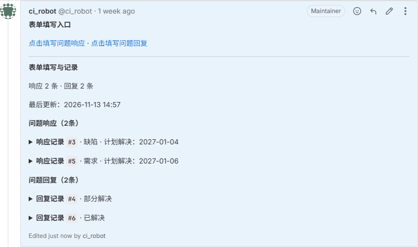
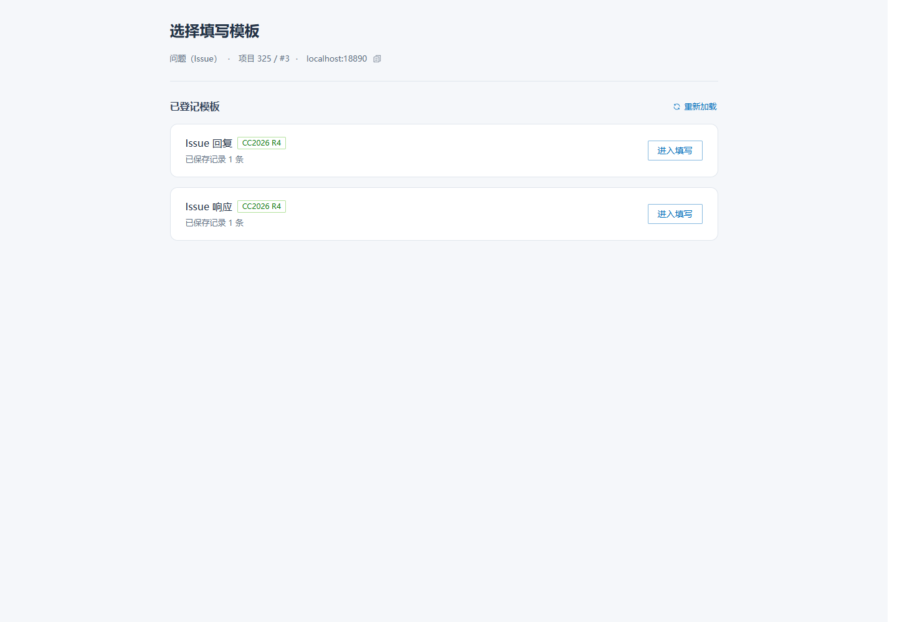
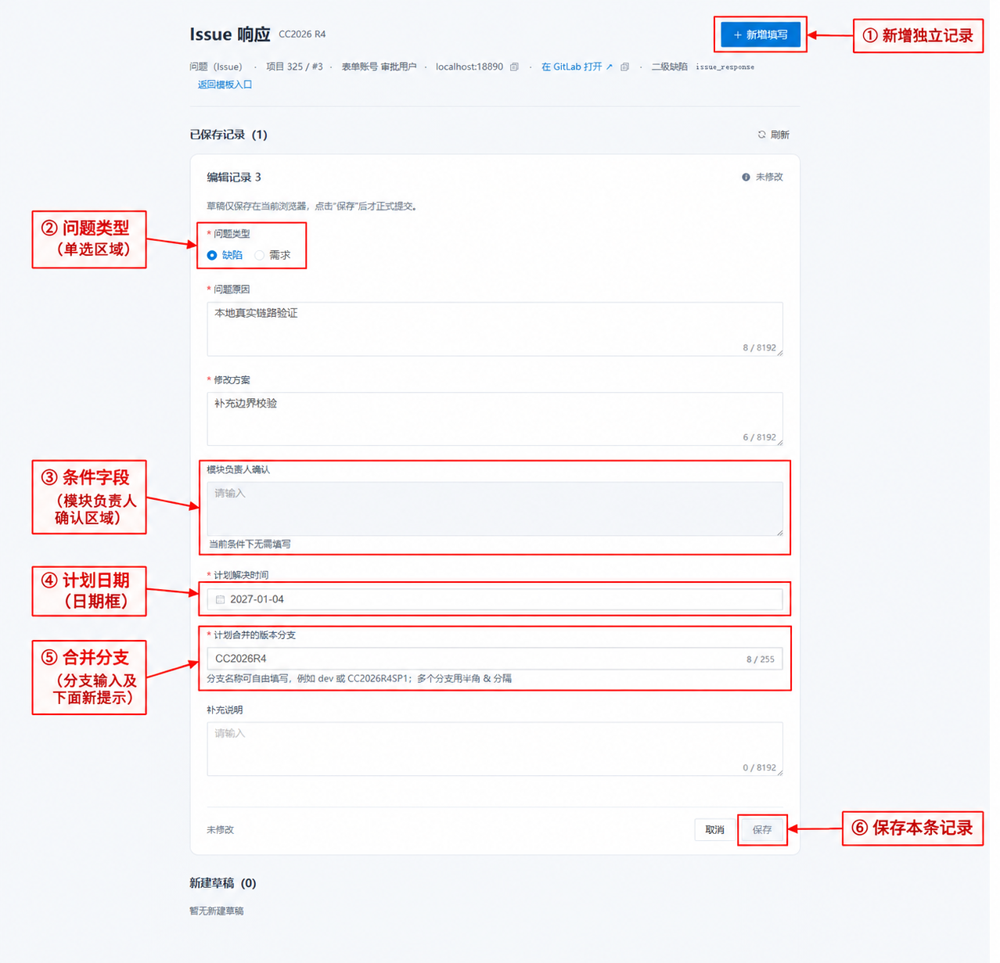
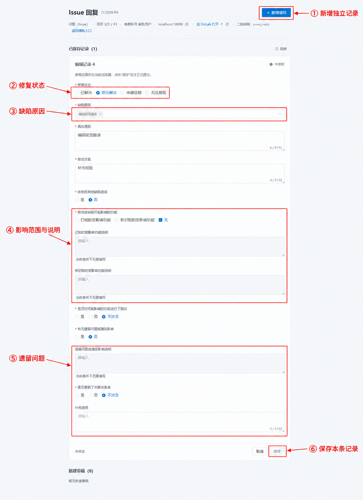
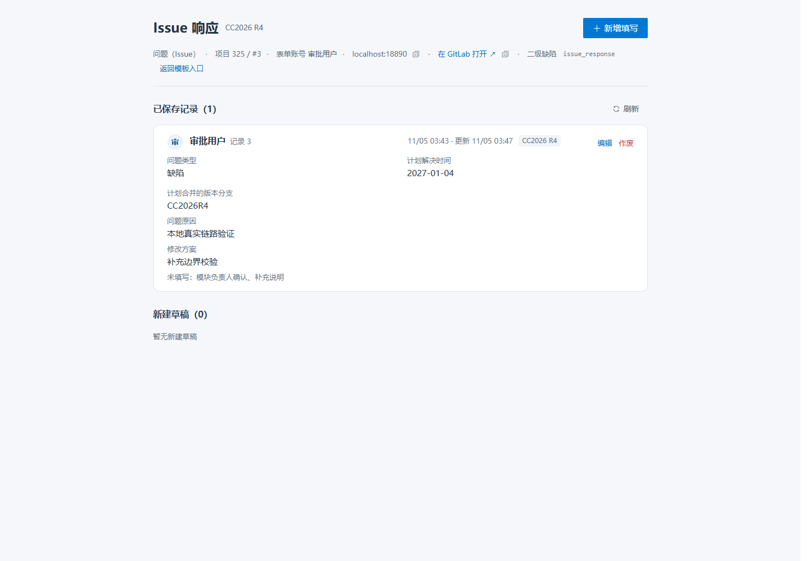
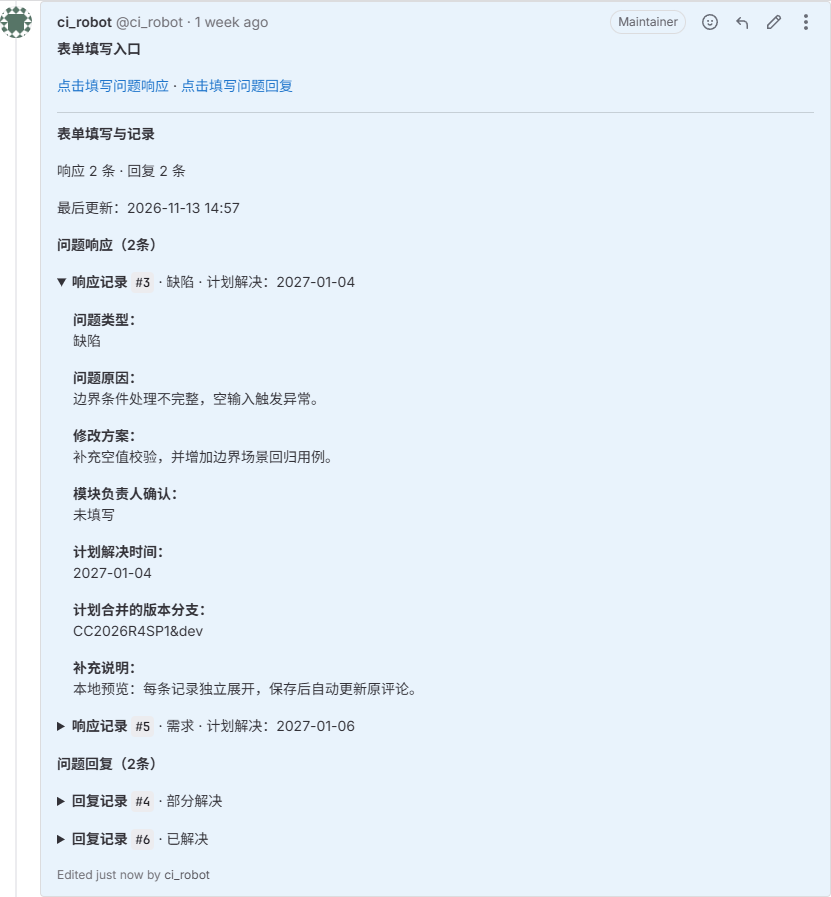

# 表单系统使用说明

自 2026 年 11 月 6 日 6:00 起创建的议题，CI_ROBOT 会在评论区自动发送表单链接，请通过链接提交响应和回复。此前创建的议题保持原有方式，继续将模板复制、粘贴到评论区填写。**评论区已有表单链接的议题，不再识别通过评论提交的旧版响应和回复模板。**

## 填写流程

**评论区链接 → 问题响应／问题回复 → 保存 → 查看处理结果。**

### 从评论区进入

“点击填写问题响应”和“点击填写问题回复”分别进入对应表单，链接对应当前议题。两张表分别保存，需要切换时使用“返回模板入口”。

**响应记录分析和计划，回复记录处理结果。** 截图中的地址、项目及记录均为本地示例，实际使用议题评论中的链接。

↓

### 问题响应

**分析与计划 → 保存本条响应。** 新增形成独立记录，修正已有内容使用“编辑”。

支持 `dev`、`CC2026R4SP1` 等名称，多个分支用 `&` 分隔。

↓

### 问题回复

**处理状态与影响 → 保存本条回复。** 选择“申请延期”后，还需单选延期原因。

**申请延期 → 选择一个延期原因 → 保存。** “延期原因”与下面的“缺陷原因”是两个独立字段。

↓

### 提交完成

**草稿只在本机 → 图中⑥“保存”后成为正式记录 → 后台更新合规、统计及延期标签。**

多个草稿逐条提交。保存成功后不必因标签或统计尚未变化而重复新增。

**在记录卡核对结果；纠正原内容用“编辑”，撤销整条记录用“作废”。**

保存后也可回到议题评论区，展开单条记录查看完整内容；无需进入表单页才能阅读。

**每条记录独立展开，响应和回复分组展示。** 新增、编辑、作废后自动更新原评论；刷新议题页面查看更新，不会每次新增一条评论。尚无记录时显示“暂未填写”，作废记录不再展示。

---

## 规则说明

### 链接与议题的对应关系

链接在议题采集及相关数据处理完成后投放，可能晚于议题创建时间。未收到链接时，请先联系管理员核查处理状态。

填写链接与议题绑定，请勿通过修改链接中的议题编号复用其他议题入口。页头可查看项目、议题编号、当前账号和 GitLab 来源。

### 问题响应：记录分析与处理计划

响应和回复分别保存，互不覆盖。响应中的计划发生变化时，需要区分是在修正原记录，还是形成一次新的响应。

#### 新增与编辑影响什么

图中 **①“新增填写”** 会生成一条独立记录；修改已有响应应在原记录上编辑。每条记录保留自己的创建人、创建时间和版本。

**最新响应按有效记录的创建时间选取，编辑旧响应不会改变它的先后顺序。** 例如先有响应 A，后新增响应 B，再编辑 A，B 仍是较新的响应。需要形成新的阶段响应时新增，需要修正 A 的原始内容时编辑 A。

记录由创建人维护。其他人能查看记录，并不意味着可以代改或作废；管理员维护模板的权限也不等于代改他人记录的权限。

#### 计划日期与合并分支

图中 **④、⑤** 是处理计划。计划解决时间要求完整、有效的日期；计划合并分支支持自由名称，多个分支统一使用半角 `&` 分隔。

| 情况               | 写法                                                |
| ------------------ | --------------------------------------------------- |
| 开发分支           | `dev`                                             |
| 常规版本或补丁版本 | 单个分支可填写 `CC2027R1` 或 `CC2026R4SP1`      |
| 自定义分支         | 单个分支可填写 `release/2027` 或 `hotfix/login` |
| 同时合并多个分支   | `dev&CC2026R4SP1` 或 `CC2027R1&CC2027R2`        |

分支字段必填，最多 255 个字符。不能使用逗号、顿号、分号或全角 `＆` 代替分隔符，也不能出现 `dev&&CC2026R4SP1`、`&dev`、`dev&` 这样的空成员。

分支名称本身不会自动转换成看板版本。

#### 条件字段与原有内容

“模块负责人确认”在一级缺陷时必填，其他不适用情况下置灰。字段的启用和必填状态由议题信息及表单条件决定。

涉及已填内容清空时，页面会给出确认提示。确认后被清空的内容不再随本次记录提交；取消确认则继续保留原输入。

### 问题回复：反馈结果与申请延期

回复可记录“已解决”“部分解决”“申请延期”或“无法复现”。改变修复状态不会自动完成提交，仍需保存当前记录；也不会直接改写响应表中的处理计划。

#### 申请延期及后续变更

图中 **②“修复状态”** 选择“申请延期”后，会出现必填的“延期原因”，在 **技术卡点、资源卡点、数据异常** 中单选，见上方延期截图。

| 回复变化                       | 表单变化                   | 保存后的后台处理                                     |
| ------------------------------ | -------------------------- | ---------------------------------------------------- |
| 改为申请延期                   | 显示延期原因，必须选择一项 | 按有效记录处理申请延期及对应原因标签                 |
| 延期原因由技术卡点改为资源卡点 | 保留申请延期状态，更新原因 | 按新原因调整标签                                     |
| 由申请延期改为已解决等其他状态 | 延期原因隐藏并清空         | 按更新后的有效记录处理延期标签                       |
| 作废延期回复                   | 该条记录不再有效           | 重新按剩余有效记录计算，不等同于强制取消所有延期状态 |

标签由后台异步处理，保存成功时可能尚未更新。已有标签不会重复添加，非延期相关标签保持原有状态。出现延迟时，先确认记录是否保存成功，再排查后台处理，不要重复新增相同回复。

“延期原因”与图中 **③“缺陷原因”** 各自独立：前者描述延期卡点且严格单选，后者描述缺陷成因且支持多选。**能保存多选原因不等于合规通过**，现有合规规则对适用记录仍检查原因唯一性。

#### 影响范围与遗留问题

图中 **④、⑤** 会控制后续说明是否需要填写：

| 当前选择                     | 对应规则                                     |
| ---------------------------- | -------------------------------------------- |
| 勾选“已知的受影响功能”     | 对应说明必填                                 |
| 勾选“新识别的受影响功能”   | 对应说明必填，可与已知受影响功能同时选择     |
| 选择“无”                   | 不能同时选择上面两项；不再适用的说明会被清空 |
| 遗留问题或潜在影响选择“是” | 遗留问题或潜在影响说明必填                   |
| 遗留问题或潜在影响选择“否” | 对应说明不再适用并清空                       |

有已填说明时，切换条件须留意清空提示。是否完成影响测试、是否更新关联关系表仍按实际情况独立选择，不因勾选了影响范围而自动判定。

### 保存、后台处理与记录撤销

两张图中的 **⑥“保存”** 只提交所在的那条记录。多个草稿各自独立，保存其中一条不会一并提交其他草稿。截图处于“未修改”状态，保存按钮置灰属于正常表现。

**本机草稿 → 正式保存记录 → 后台更新业务结果** 是三个不同阶段。

| 阶段     | 当前状态                             | 对使用者的影响                                             |
| -------- | ------------------------------------ | ---------------------------------------------------------- |
| 本机草稿 | 内容留在当前浏览器，尚未正式提交     | 不参与平台后续处理；换电脑、换浏览器不能依赖该草稿继续工作 |
| 保存成功 | 平台已接收并保存记录                 | 可以在记录列表中核对结果，无需重复提交                     |
| 后台处理 | 更新事实、合规、统计及适用的延期标签 | 业务结果可能晚于保存成功；保存成功也不代表合规检查已通过   |

记录列表不会实时推送其他人的变化，需要时使用列表“刷新”。页面刷新记录列表会保留当前草稿；清除浏览器数据则可能丢失尚未提交的本机内容。普通填写不需要手动触发全量同步或事实重建。

#### 取消与作废的边界

**取消**处理当前未提交内容，确认丢弃后不会撤销之前已保存的记录。**作废**针对已保存的有效记录，需要确认并输入“作废”。

作废后的记录不再出现在有效记录集合中，也不再参与对应统计、导出及首次／最新记录选择，但后台保留审计。作废最新记录后，后续结果可能重新依据剩余有效记录计算。

若仅需纠正内容，直接编辑；重复记录、填错对象等需要撤销整条记录的情况再作废。已经提交或已作废的操作，不会因为关闭浏览器而撤回。

#### 提交没有正常结束时

| 情况                   | 系统如何处理                                           | 后续操作                                             |
| ---------------------- | ------------------------------------------------------ | ---------------------------------------------------- |
| 必填或格式校验失败     | 不完成本次保存，保留输入                               | 修正提示字段后再保存                                 |
| 正在提交               | 当前提交尚未返回结果                                   | 等待结果，避免另开草稿重复提交                       |
| 提交结果未知           | 无法确认请求是否已经成功，保留原提交内容并限制后续操作 | 使用“核验提交结果”；未核验完成前，不按失败直接重填 |
| 同一条记录发生编辑冲突 | 不静默覆盖已经变化的记录                               | 对照最新记录处理冲突，保留仍需要的修改               |
| 不同人新增不同记录     | 各自独立保存，不互相覆盖                               | 按记录核对；业务上的最新／有效选择仍遵循对应规则     |
| 登录失效或账号发生变化 | 暂停原账号下的提交，草稿按账号隔离                     | 重新登录原账号并检查草稿；有待确认提交时先核验结果   |
| 本机草稿保存失败       | 内容可能只保留在当前页面                               | 先保留页面或复制未提交文字，再处理故障，避免直接关闭 |

多人或多个标签页同时操作时，另一页面已保存不代表当前未提交内容也已保存。若系统提示记录变化、草稿副本变化或提交待确认，按当前提示处理，不用重复新增来绕开冲突。

### 再次打开、版本变化与只读状态

再次打开时，已保存记录与本机草稿分别展示。恢复草稿不等于补交成功，仍需保存；离开页面时选择保留草稿，也不会把内容提交到平台。

表单发布后续迭代更新后，**新记录使用当前已发布版本，旧记录保留原版本及原值**。新版增加字段不会要求旧记录补填，新版删除字段也不会删除旧记录中已保存的值。正常可写范围内，原创建人仍按旧记录所属版本编辑或作废，不需要为迁移版本而重复录入。

| 情况                                               | 处理原则                                                                     |
| -------------------------------------------------- | ---------------------------------------------------------------------------- |
| 填写过程中模板版本或范围发生变化                   | 系统保留原输入并提示变化；按页面提示处理，不把旧草稿未经核对直接提交到新结构 |
| 所属记录版本暂时无法读取                           | 保留内容，待版本恢复或管理员核查；不把字段缺失当作空值覆盖保存               |
| 账号无维护权限、非本人记录、账号停用或范围退役     | 以页面只读提示为准；查看权限不代表编辑权限                                   |
| 已关闭新议题的表单接入                             | 停止新增接入和链接投放，既有表单身份、记录及其维护规则仍保留                 |
| 没有入口、数据暂未就绪、持续保存失败或页面样式异常 | 将议题链接、当前账号、完整提示及截图交给管理员；样式异常时同时提供浏览器版本 |

响应、回复、历史记录和后续标签应围绕同一议题核对。遇到异常时，先保留未提交内容并确认当前记录状态，再决定编辑、重新提交或作废。
